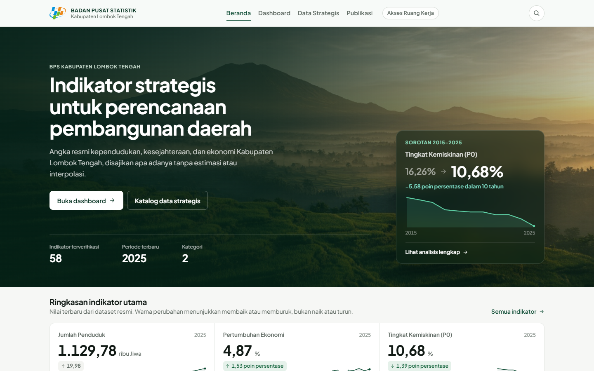
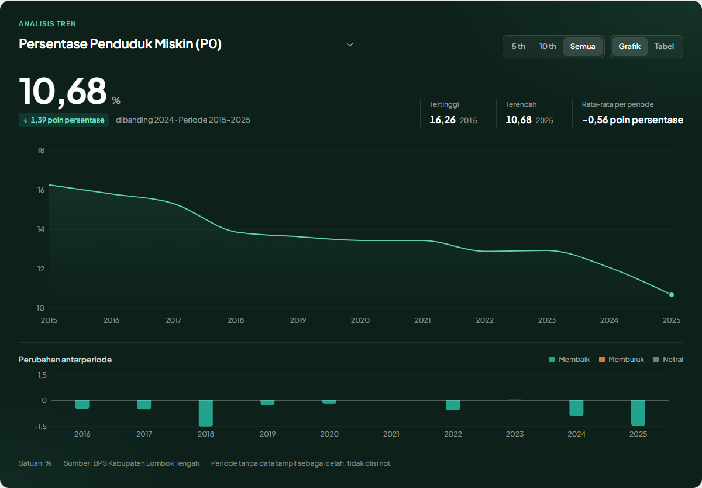

# Dashboard Indikator Strategis BPS Kabupaten Lombok Tengah

Aplikasi web untuk menyajikan 58 indikator strategis Kabupaten Lombok Tengah kepada
masyarakat, sekaligus menyediakan ruang kerja internal bagi petugas untuk memutakhirkan
data melalui alur persetujuan.

Proyek ini dikembangkan sebagai Capstone Project Program Studi Teknik Informatika
STMIK Lombok (2026) oleh Kelompok 6.



## Fitur

**Halaman publik** (tanpa login)

- Dashboard dengan filter kategori, periode, dan pencarian indikator
- Panel analisis tren: nilai terbaru, tertinggi dan terendah, grafik deret waktu, serta
  perubahan antarperiode
- Penanda perubahan berdasarkan makna indikator (membaik, memburuk, atau netral), bukan
  sekadar naik atau turun
- Panel rincian indikator dan unduhan Excel sesuai filter
- Nilai kosong pada data sumber tetap kosong, tidak diisi nol atau estimasi

**Ruang kerja internal**

- Operator menyusun usulan nilai baru dan mengajukannya untuk ditinjau
- Administrator menolak dengan alasan atau menyetujui dan memublikasikan
- Data publik hanya berubah setelah usulan disetujui
- Riwayat audit mencatat pelaku, waktu, nilai lama, dan nilai baru setiap aktivitas



## Teknologi

| Lapisan | Teknologi |
|---|---|
| Antarmuka | React 19, TypeScript, Vite, React Router, Recharts |
| Layanan API | Node.js, Express 5, Zod |
| Basis data | Prisma ORM, SQLite (pengembangan), PostgreSQL (produksi) |
| Keamanan | bcrypt, JSON Web Token dalam cookie HttpOnly, hak akses per peran di server |
| Pengujian | Uji API otomatis, Playwright untuk uji peramban, pemeriksa integritas data |

## Menjalankan secara lokal

Prasyarat: Node.js 20.19 atau lebih baru dan Google Chrome (untuk uji peramban).

```bash
npm install
npm --prefix server install

cp .env.example .env
cp server/.env.example server/.env

npm run db:generate
npm run db:push
npm run db:seed

npm run dev:api   # API di http://localhost:4000
npm run dev       # aplikasi di http://localhost:5173
```

Akun pengembangan untuk ruang kerja:

| Peran | Username | Password |
|---|---|---|
| Administrator | `admin` | `dev-admin-only` |
| Operator | `operator` | `dev-operator-only` |

Akun ini hanya untuk lingkungan pengembangan dan harus diganti sebelum aplikasi
dipasang di server produksi.

## Pengujian

```bash
npm run test:data       # integritas data indikator
npm run test            # uji API (API harus berjalan)
npm run test:browser    # uji peramban (API dan aplikasi harus berjalan)
npm run typecheck && npm run typecheck:api
npm run build && npm run build:api
```

Hasil terakhir: 47 dari 47 uji API dan 64 dari 64 uji peramban lulus.

## Struktur proyek

```
src/                 antarmuka React (halaman, komponen, autentikasi, utilitas)
server/              layanan API Express dan skema Prisma
scripts/             pengujian, pengambilan screenshot, dan pembangkit dokumen
docs/                dokumentasi teknis
docs/laporan-capstone/   laporan, presentasi, dan panduan penggunaan
data/                berkas sumber data indikator
```

## Dokumentasi

- [Arsitektur](docs/ARCHITECTURE.md), [API](docs/API.md), [Autentikasi](docs/AUTH.md),
  [Alur kerja data](docs/WORKFLOW.md)
- [Serah-terima teknis untuk BPS](docs/BPS_HANDOVER.md) dan
  [daftar periksa integrasi](docs/BPS_INTEGRATION_CHECKLIST.md)
- [Panduan demo](docs/DEMO_GUIDE.md) dan [deployment](docs/DEPLOYMENT.md)
- [Laporan dan presentasi Capstone](docs/laporan-capstone/)

## Batasan

Integrasi Single Sign-On BPS, WebAPI resmi BPS, dan hosting produksi belum termasuk
dalam proyek ini dan menunggu spesifikasi dari BPS. Modul manajemen pengguna dan
pengaturan sistem baru tersedia sebagai menu.

## Tim

Kelompok 6, Program Studi Teknik Informatika STMIK Lombok

- Baiq Agestia Cahya Ilami (ketua)
- Agus Muliadi
- M. Fahrurrozi
- Jizia Farhani Fikri

Dosen pengampu: Sofiansyah Fadli, S.Kom., M.Kom.

Data indikator bersumber dari Badan Pusat Statistik Kabupaten Lombok Tengah.
